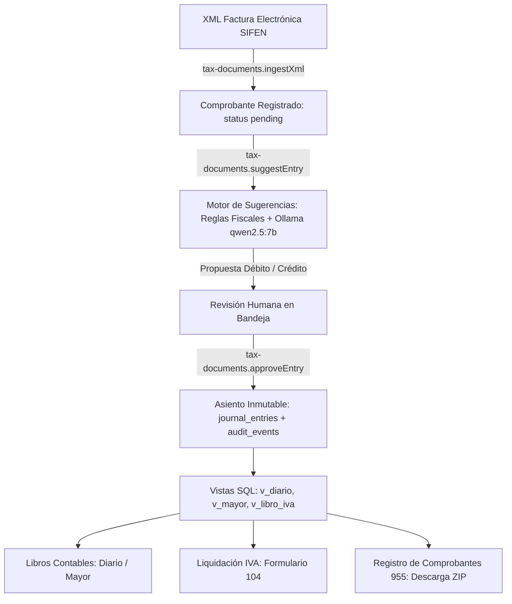

# InteliCont — Documentación de la API

La API de InteliCont está estructurada principalmente mediante **tRPC v11** para operaciones tipadas end-to-end, complementada con rutas HTTP REST específicas para autenticación y descarga de archivos binarios/ZIP.

---

## 🔒 Reglas de Autenticación, RLS y Seguridad

Todas las solicitudes a la API siguen reglas estrictas de seguridad:
1. **Identidad**: Obtenida exclusivamente a través de cookies de sesión firmadas gestionadas por **Better Auth** (rutas bajo `/api/auth/*`).
2. **2FA Obligatorio**: Usuarios con rol de administrador en una empresa requieren autenticación en dos factores (TOTP) activa; de lo contrario, las llamadas devuelven `403 FORBIDDEN ("2FA requerido")`.
3. **Multi-Tenancy Aislado**: Las llamadas autenticadas corren dentro de `withTenant(userId, fn)` que establece el contexto transaccional en Postgres (`app.user_id` y `app.entity_ids`). Los repositorios leen y escriben a través de `tenantDb(fn)`.
4. **Idempotencia en Mutaciones**: Todas las mutaciones de negocio utilizan `idempotentProcedure` y exigen el encabezado HTTP:
   ```http
   Idempotency-Key: <UUID v4>
   ```
   Si se reenvía una solicitud con el mismo UUID y el mismo payload, se retorna la respuesta previamente procesada sin re-ejecutar la mutación. Si el payload varía, retorna `422 UNPROCESSABLE_CONTENT`.
5. **Formateo Seguro de Errores**: Todo error imprevisto de servidor (`INTERNAL_SERVER_ERROR`) es enmascarado para el cliente devolviendo el mensaje genérico `"Error interno del servidor"` acompañado de un `requestId`. El stack trace y los datos SQL se guardan de forma segura en los logs de Pino en el servidor (usando `safeErrorInfo`).

---

## 🔄 Flujo de Datos del Vertical Slice



---

## 📡 Routers tRPC

### 1. `health`
* **`health`** (`publicProcedure.query`): Retorna el estado del servicio y timestamp actual.

### 2. `entities`
* **`list`** (`protectedProcedure.query`): Lista todas las empresas a las que el usuario autenticado tiene membresía activa.
* **`get`** (`protectedProcedure.query`): Detalle de una entidad por `{ id: UUID }`.
* **`create`** (`idempotentProcedure.mutation`): Crea una nueva empresa y asigna al usuario como administrador.
  * *Input*: `{ ruc: string, legalName: string, tradeName?: string, baseCurrency?: string, taxRegimes?: string[] }`
  * *Output*: Entidad creada.

### 3. `accounts`
* **`list`** (`protectedProcedure.query`): Obtiene todas las cuentas contables de una entidad.
  * *Input*: `{ entityId: UUID }`
* **`tree`** (`protectedProcedure.query`): Obtiene el plan de cuentas estructurado jerárquicamente en árbol.
  * *Input*: `{ entityId: UUID }`

### 4. `journal-entries`
* **`list`** (`protectedProcedure.query`): Lista asientos contables con paginación.
  * *Input*: `{ entityId: UUID, limit?: number, offset?: number }`
* **`count`** (`protectedProcedure.query`): Conteo total de asientos para la entidad.
  * *Input*: `{ entityId: UUID }`
* **`get`** (`protectedProcedure.query`): Obtiene un asiento por ID con sus líneas contables.
  * *Input*: `{ id: UUID }`
* **`getLines`** (`protectedProcedure.query`): Obtiene las líneas contables de un asiento específico.
  * *Input*: `{ entryId: UUID }`
* **`create`** (`idempotentProcedure.mutation`): Crea y postea un asiento contable manual verificado.
  * *Input*: `{ entityId: UUID, date: string (YYYY-MM-DD), description: string, lineas: Array<{ accountId: UUID, debit: number, credit: number, description?: string, partnerId?: UUID }> }`
  * *Validaciones*: Partida doble obligatoria (`sum(debit) === sum(credit)`), importe en enteros Gs. (mínimo 2 líneas).
* **`reverse`** (`idempotentProcedure.mutation`): Revierte un asiento creando su contra-asiento correspondiente.
  * *Input*: `{ entryId: UUID, reason: string }`
  * *Efecto*: Crea contra-asiento referenciando al original en `reversal_of` y registra evento en auditoría.

### 5. `tax-documents`
* **`list`** (`protectedProcedure.query`): Lista comprobantes fiscales con filtros opcionales.
  * *Input*: `{ entityId: UUID, status?: sifenStatus, period?: string }`
* **`pending`** (`protectedProcedure.query`): Lista comprobantes en estado pendiente de aprobación/contabilización.
  * *Input*: `{ entityId: UUID }`
* **`get`** (`protectedProcedure.query`): Detalle del comprobante fiscal por `{ id: UUID }`.
* **`getLines`** (`protectedProcedure.query`): Líneas de ítems del comprobante por `{ documentId: UUID }`.
* **`ingestXml`** (`idempotentProcedure.mutation`): Procesa e ingesta un archivo XML de factura electrónica SIFEN.
  * *Input*: `{ entityId: UUID, xmlContent: string }`
  * *Validaciones*: Verifica CDC (44 dígitos, DV mod 11), vigencia de timbrado, emisor/receptor, totales e IVA.
* **`previewManual`** (`protectedProcedure.query`): Previsualiza el desglose de IVA y retenciones para carga manual.
  * *Input*: Datos del comprobante manual (tipo, proveedor, número, timbrado, importes gravados/exentos).
* **`createManual`** (`idempotentProcedure.mutation`): Registra un comprobante manual (no electrónico) para compras o ventas.
  * *Input*: Campos de documento, timbrado, líneas con desglose fiscal o total único.
* **`suggestEntry`** (`authedProcedure.mutation`): Genera la propuesta de contabilización para un documento pendiente.
  * *Nota*: Corre fuera de una transacción DB prolongada para invocar de forma segura al modelo Ollama (`qwen2.5:7b`) o resolver mediante reglas locales.
* **`approveEntry`** (`idempotentProcedure.mutation`): Aprueba la propuesta contable, genera el asiento inmutable y actualiza el documento.
  * *Input*: `{ documentId: UUID, lines: Array<{ accountId: UUID, debit: number, credit: number }> }`
* **`rejectSuggestion`** (`idempotentProcedure.mutation`): Rechaza una sugerencia y marca el documento para revisión manual.

### 6. `partners`
* **`list`** (`protectedProcedure.query`): Lista clientes y proveedores de la entidad.
  * *Input*: `{ entityId: UUID, search?: string, kind?: "customer" | "supplier" | "both" }`
* **`get`** (`protectedProcedure.query`): Detalle de un tercero por `{ id: UUID }`.
* **`create`** (`idempotentProcedure.mutation`): Crea un nuevo cliente o proveedor.
  * *Input*: `{ entityId: UUID, ruc: string, legalName: string, tradeName?: string, kind: partnerKind, retentionProfile?: object }`
* **`update`** (`idempotentProcedure.mutation`): Actualiza los datos de un tercero.

### 7. `fiscal`
* **`periods`** (`protectedProcedure.query`): Períodos fiscales creados para la entidad.
* **`currentPeriod`** (`protectedProcedure.query`): Período fiscal en curso.
* **`form104`** (`protectedProcedure.query`): Pre-liquidación del Formulario 104 de IVA mensual (débito, crédito y saldo técnico).
  * *Input*: `{ entityId: UUID, year: number, month: number }`
* **`vencimientoIva`** (`protectedProcedure.query`): Fecha de vencimiento según último dígito del RUC (calendario perpetuo).
* **`registroPreview`** (`protectedProcedure.query`): Previsualiza las filas que integrarán el Registro de Comprobantes 955.
  * *Input*: `{ entityId: UUID, year: number, month: number }`
  * *Output*: Resumen de archivos (ventas/compras), total de comprobantes, errores y exclusiones.
* **`upcoming`** (`protectedProcedure.query`): Próximos vencimientos fiscales calculados para la entidad.
* **`calendarMonth`** (`protectedProcedure.query`): Calendario completo de obligaciones del mes seleccionado.

### 8. `reports`
* **`diario`** (`protectedProcedure.query`): Libro Diario oficial agrupado cronológicamente por asiento.
  * *Input*: `{ entityId: UUID, from?: string, to?: string }`
* **`mayor`** (`protectedProcedure.query`): Libro Mayor con movimientos y saldos acumulados por cuenta.
  * *Input*: `{ entityId: UUID, accountId?: UUID, from?: string, to?: string }`
* **`sumasSaldos`** (`protectedProcedure.query`): Balance de Sumas y Saldos (Comprobación).
  * *Input*: `{ entityId: UUID, from?: string, to?: string }`
* **`libroIva`** (`protectedProcedure.query`): Libro IVA Compras y Ventas desglosado por tasa (10%, 5%, exento).
  * *Input*: `{ entityId: UUID, year: number, month: number }`

### 9. `audit`
* **`list`** (`protectedProcedure.query`): Consulta paginada de la bitácora de auditoría.
  * *Input*: `{ entityId: UUID, entityType?: string, action?: string, userId?: UUID, limit?: number, offset?: number }`
* **`actions`** (`protectedProcedure.query`): Lista de tipos de acciones registradas para filtrar en la UI.

---

## 🌐 Endpoints HTTP REST

### Descarga de Registro de Comprobantes
* **`GET /api/registro/{entityId}/{period}?part={N}`**
  * *Parámetros*:
    * `entityId`: UUID de la empresa.
    * `period`: Mes y año en formato `MMAAAA` (ej. `102026`).
    * `part`: Número de lote (por defecto `1`, máximo 5.000 filas por archivo según normativa DNIT).
  * *Seguridad*: Sesión requerida y verificación de membresía + 2FA para administradores.
  * *Respuesta*: Archivo `.zip` con cabecera `Content-Type: application/zip`, conteniendo el archivo de texto plano delimitado listo para su carga en Marangatu.

### Autenticación (Better Auth)
* **`/api/auth/*`**
  * Handlers estándar de Better Auth para inicio de sesión con email/password, verificación de sesión y flujo TOTP.
  * *Nota*: El auto-registro (`sign-up`) público se encuentra deshabilitado; los usuarios administradores se crean vía CLI (`pnpm auth:create-user`).

### Verificación de Estado (Healthcheck)
* **`GET /api/health`**
  * Endpoint HTTP simple para probes de orquestadores (Coolify/Docker) respondiendo `{ "status": "ok" }`.
