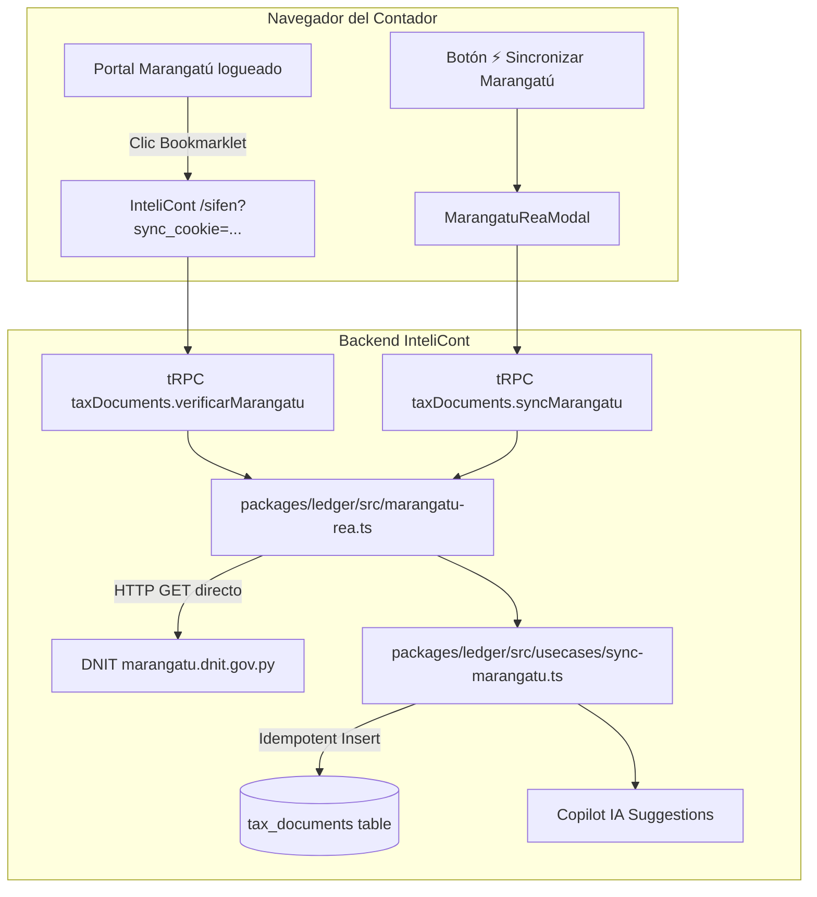

# Sub-sistema de Sincronización Directa DNIT Marangatú (Protocolo REA) Implementation Plan

> **For agentic workers:** REQUIRED SUB-SKILL: Use superpowers:subagent-driven-development to implement this plan task-by-task. Steps use checkbox (`- [ ]`) syntax for tracking.

**Goal:** Implementar el conector REA (Reverse Engineering API de Marangatú) en InteliCont para sincronizar compras y ventas de la RG 90 en < 1 segundo directamente desde la sesión activa de la DNIT con Bookmarklet 1-Clic e ingesta automática en `tax_documents`.

**Architecture:**
- Módulo `packages/ledger/src/marangatu-rea.ts`: Cliente HTTP nativo (Node `fetch`) que normaliza la sesión de Marangatú (`consultarSesion.do`), lista talones (`talones`) y parsea registros de compras y ventas de la RG 90 a montos enteros en Guaraníes.
- Caso de uso `packages/ledger/src/usecases/sync-marangatu.ts`: Ingesta atómica e idempotente en `tax_documents` bajo aislamiento RLS por `entityId`, reusando `validateCDC` y las reglas fiscales de `packages/ledger/src/fiscal-py.ts`.
- Router tRPC `tax-documents.ts`: Endpoints `verificarMarangatu` y `syncMarangatu`.
- Frontend: Modal interactivo `MarangatuReaModal.tsx` con generador de Bookmarklet 1-Clic y botón de acceso en `/sifen` e `/importar`.

**Architecture Diagram:**

**Tech Stack:** TypeScript, Node native fetch, Drizzle ORM, tRPC v11, React 19, TailwindCSS, Vitest.

**Spec:** [docs/superpowers/specs/2026-10-25-dnit-marangatu-rea-design.md](file:///Users/gustaquevedo/Library/CloudStorage/OneDrive-Personal/Dev/Intelicont/docs/superpowers/specs/2026-10-25-dnit-marangatu-rea-design.md)

## Global Constraints
- Regla 9: Dinero entero sin decimales (PyG bigint/integer).
- Regla 3: Multi-tenant por `entityId` con Postgres RLS (`withTenant` / `tenantDb`).
- Directriz Ponytail: Cero dependencias pesadas innecesarias. Reusar `validateCDC` y `validateRuc` de `fiscal-py.ts`.
- 100% de la suite de tests pasando en cada paso.

---

### Task 1: Cliente HTTP Marangatú y Parser de Comprobantes REA

**Files:**
- Create: `packages/ledger/src/marangatu-rea.ts`
- Create: `packages/ledger/src/__tests__/marangatu-rea.test.ts`

**Interfaces:**
- Produces: `cleanCookie(cookieRaw: string): string`
- Produces: `MarangatuHttpClient`:
  - `verificarSesion(cookie: string): Promise<{ valido: boolean; ruc?: string; nombre?: string; error?: string }>`
  - `listarTalones(cookie: string, ruc: string, periodo: string): Promise<any[]>`
  - `descargarComprobantes(cookie: string, idTalon: string): Promise<MarangatuDocumento[]>`
- Produces: `parsearRegistrosMarangatu(payload: any): MarangatuDocumento[]`

- [x] **Step 1: Escribir tests unitarios para marangatu-rea**
- [x] **Step 2: Ejecutar test y verificar que falla (Red)**
- [x] **Step 3: Implementar marangatu-rea.ts con fetch nativo y normalización**
- [x] **Step 4: Ejecutar test y verificar que pasa (Green)**
- [x] **Step 5: Commit de Task 1**

---

### Task 2: Caso de Uso `syncMarangatu` y Procedimientos tRPC

**Files:**
- Create: `packages/ledger/src/usecases/sync-marangatu.ts`
- Modify: `packages/ledger/src/usecases/index.ts`
- Create: `apps/web/src/__tests__/tax-documents-sync.test.ts`
- Modify: `apps/web/src/trpc/routers/tax-documents.ts`

**Interfaces:**
- Produces: `syncMarangatuUsecase(input: { entityId: string; cookie: string; periodo: string; tipo: "compras" | "ventas" | "ambos" }): Promise<Result<{ total: number; compras: number; ventas: number; duplicados: number }, string>>`
- Produces: `taxDocuments.verificarMarangatu` en tRPC
- Produces: `taxDocuments.syncMarangatu` en tRPC

- [x] **Step 1: Escribir test de integración para syncMarangatu**
- [x] **Step 2: Ejecutar test y verificar que falla (Red)**
- [x] **Step 3: Implementar sync-marangatu.ts e integrarlo en tax-documents router**
- [x] **Step 4: Ejecutar test y verificar que pasa (Green)**
- [x] **Step 5: Commit de Task 2**

---

### Task 3: Modal de Sincronización REA y Conector Bookmarklet

**Files:**
- Create: `apps/web/src/components/marangatu-rea-modal.tsx`
- Modify: `apps/web/src/app/sifen/page.tsx`
- Modify: `apps/web/src/app/importar/page.tsx`

**Interfaces:**
- Produces: `<MarangatuReaModal entityId={entityId} entityRuc={entityRuc} open={open} onOpenChange={setOpen} onSyncSuccess={refresh} />`
- Modifies: Botón "⚡ Sincronizar Marangatú (1-Clic REA)" y manejo de `sync_cookie` en query param.

- [x] **Step 1: Crear componente MarangatuReaModal con Bookmarklet interactivo y verificador de sesión**
- [x] **Step 2: Integrar el botón y detector de sync_cookie en /sifen y /importar**
- [x] **Step 3: Verificar visual y funcionalmente en la app**
- [x] **Step 4: Commit de Task 3**

---

### Task 4: Verificación Integral de Suite, Build y Documentación

**Files:**
- Test: Suite completa `pnpm test`
- Build: Compilación de producción `pnpm build`
- Git: Push a `origin/main`

- [x] **Step 1: Ejecutar la suite completa de tests de InteliCont (260+ tests)**
- [x] **Step 2: Ejecutar build de producción Next.js**
- [x] **Step 3: Commit final y sincronización con origin/main**
- [x] **Step 4: Resumen final con <!-- GOAL_COMPLETE -->**
