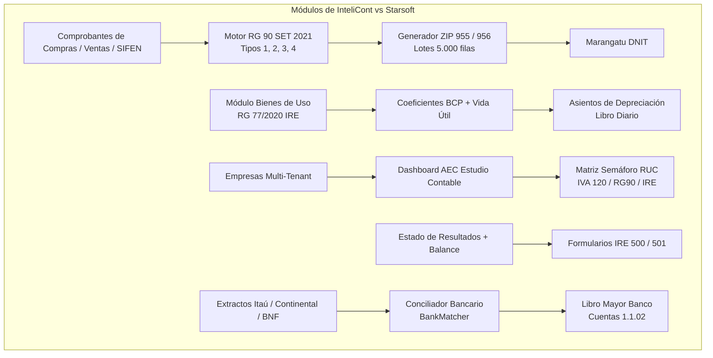

# Starsoft Expert 360 Parity & RG 90 Official Spec Implementation Plan

> **For agentic workers:** REQUIRED SUB-SKILL: Use superpowers:subagent-driven-development to implement this plan task-by-task. Steps use checkbox (`- [ ]`) syntax for tracking.

**Goal:** Implementar de forma integral y homologada los 5 pilares contables que diferencian y superan a Starsoft Expert 360 en Paraguay: (1) Motor estricto de RG 90 según la Especificación Técnica Oficial SET/DNIT Junio 2021 (Ventas, Compras, Ingresos, Egresos, ZIP 955/956); (2) Módulo de Bienes de Uso / Activos Fijos conforme a la RG 77/2020 IRE; (3) Administrador de Estudio Contable (AEC) con matriz multicompañía y semáforo de vencimientos DNIT; (4) Proyección oficial de Formularios IRE 500 e IRE Simple 501; y (5) Conciliador bancario automático con bancos locales (Itaú, Continental, BNF, Ueno, Familiar, GNB).

**Architecture:** La solución se basa en una arquitectura modular TypeScript/PostgreSQL (Drizzle ORM) con RLS estricto multi-tenant:
- En `packages/ledger/src/registro-comprobantes.ts`, se expande el generador puro para soportar los 4 tipos de registros fiscales (1: Ventas, 2: Compras, 3: Ingresos, 4: Egresos) con compresión ZIP sincrónica idéntica al archivo interno y delimitador `;` / `\t` según especificación técnica SET 2021.
- En `packages/ledger/db/schema.ts`, se definen las tablas `fixed_assets`, `fixed_asset_depreciations` y `bank_statements` persistentes.
- En `packages/ledger/src/fixed-assets.ts`, se implementa el motor de revalúo con coeficientes BCP y depreciación lineal RG 77/2020 que genera asientos en el diario.
- En `apps/web/src/app/portal/` y `apps/web/src/app/empresas/`, se crea el Dashboard AEC Matriz Multicompañía con semáforo en tiempo real de obligaciones DNIT.
- En `packages/ledger/src/form-ire.ts`, se crea la liquidación del Formulario 500 y 501 conectada al Estado de Resultados.

**Architecture Diagram:**

**Tech Stack:** Next.js 15 App Router, React 19, Tailwind CSS, tRPC v11, Drizzle ORM, PostgreSQL (Supabase/Neon con RLS), `fflate` para compresión ZIP, Vitest para TDD.

**Spec:** Especificación Técnica para Importación - Registro de Comprobantes de Ventas, Compras, Ingresos y/o Egresos (SET / DNIT, Junio 2021); Ley 6380/19 de Modernización Tributaria; RG 77/2020 de Bienes de Uso.

## Global Constraints

- **Codificación:** Todo archivo generado para Marangatú debe ser `UTF-8` sin BOM.
- **Delimitadores RG 90:** Punto y coma `;` para CSV, tabulación `\t` para TXT, salto de línea `\n`.
- **Nomenclatura ZIP:** `<RUC>_REG_MMAAAA_XXXXX.zip` (955) o `<RUC>_REG_AAAA_XXXXX.zip` (956), con el archivo interno conteniendo exactamente el mismo nombre raíz.
- **RUC sin DV:** Los campos de RUC de informante y contraparte se informan sin dígito verificador.
- **Montos Enteros:** Solo guaraníes enteros, sin decimales ni símbolos.
- **Inmutabilidad:** Todo asiento contable generado (por depreciación o ajustes bancarios) debe ser inmutable una vez posteado.
- **Aislamiento Multi-Tenant:** Toda consulta y mutación debe estar protegida por RLS con `entity_id`.

---

### Task 1: Motor RG 90 Completo según Especificación SET/DNIT (Junio 2021)

**Files:**
- Modify: `packages/ledger/src/registro-codes.ts`
- Modify: `packages/ledger/src/registro-comprobantes.ts`
- Modify: `apps/web/src/app/api/registro/[entityId]/[period]/route.ts`
- Modify: `apps/web/src/app/fiscal/registro-comprobantes/page.tsx`
- Test: `apps/web/src/__tests__/registro-comprobantes.test.ts`

**Interfaces:**
- Consumes: `RegistroDoc` con campos de tipo 1 (Ventas), tipo 2 (Compras), tipo 3 (Ingresos) y tipo 4 (Egresos).
- Produces: `buildRegistro({ ruc, year, month?, type: '955' | '956', format: 'csv' | 'txt', docs }) => RegistroResult` con archivos ZIP exactos.

- [ ] **Step 1: Escribir tests unitarios para los 4 tipos de registros del manual SET**
  - Escribir casos para Tipo 1 (Ventas, 19 columnas), Tipo 2 (Compras, 20 columnas), Tipo 3 (Ingresos, 15 columnas) y Tipo 4 (Egresos, 18 columnas).
  - Validar reglas especiales: autofactura (101), despacho de importación (107 con timbrado 0), notas de crédito (110 con número y timbrado asociado), límite de 5.000 filas por archivo con nomenclatura `V0001`, `V0002`.
- [ ] **Step 2: Ejecutar tests y confirmar que fallan los nuevos tipos 3 y 4**
  - Ejecutar `pnpm --filter web test registro-comprobantes`.
- [ ] **Step 3: Implementar generador completo en `packages/ledger/src/registro-comprobantes.ts`**
  - Agregar mapeadores `toRowVentas`, `toRowCompras`, `toRowIngresos`, `toRowEgresos`.
  - Soportar delimitador configurable (`;` para CSV y `\t` para TXT).
  - Implementar particionador automático de lotes de 5.000 comprobantes con sufijo alfanumérico `XXXXX`.
  - Implementar `zipRegistro` que empaqueta el `.csv` o `.txt` con nombre idéntico dentro del `.zip`.
- [ ] **Step 4: Actualizar endpoint `GET /api/registro/[entityId]/[period]` y router tRPC**
  - Soportar parámetro `?format=csv|txt` y `?type=955|956`.
  - Devolver el archivo ZIP binario con cabecera `Content-Type: application/zip` y `Content-Disposition: attachment; filename="<RUC>_REG_...zip"`.
- [ ] **Step 5: Actualizar interfaz gráfica en `apps/web/src/app/fiscal/registro-comprobantes/page.tsx`**
  - Agregar selector de formato (.CSV delimitado por `;` o .TXT delimitado por tabulaciones).
  - Mostrar desglose de Comprobantes de Ventas, Compras, Ingresos y Egresos.
  - Botón de descarga directa del ZIP listo para subir a Marangatú.
- [ ] **Step 6: Verificar tests unitarios y build**
  - Correr `pnpm test` y verificar 100% verde.
- [ ] **Step 7: Commit**
  - `git commit -m "feat(fiscal): complete RG 90 SET 2021 import spec with types 1-4, batching and ZIP packaging"`

---

### Task 2: Bienes de Uso y Activos Fijos (RG 77/2020 IRE)

**Files:**
- Create: `packages/ledger/src/fixed-assets.ts`
- Modify: `packages/ledger/db/schema.ts`
- Create: `packages/ledger/db/migrations/0007_fixed_assets.sql`
- Create: `apps/web/src/trpc/routers/fixed-assets.ts`
- Modify: `apps/web/src/trpc/root.ts`
- Modify: `apps/web/src/app/activos/page.tsx`
- Test: `apps/web/src/__tests__/fixed-assets.test.ts`

**Interfaces:**
- Consumes: `entityId`, cuenta contable de activo, cuenta de depreciación acumulada, fecha de compra, valor de costo, vida útil en meses, coeficiente de revalúo oficial BCP.
- Produces: Cuadro de Bienes de Uso conforme a RG 77/2020 y generación de asientos contables automáticos (Debe: Gasto de Depreciación / Haber: Depreciación Acumulada).

- [ ] **Step 1: Escribir tests unitarios para el motor de revalúo y depreciación RG 77/2020**
  - Probar depreciación lineal por mes y anual.
  - Probar aplicación de coeficiente de revalúo del BCP sobre costo histórico.
  - Probar cálculo de valor residual y valor fiscal neto al cierre del ejercicio.
- [ ] **Step 2: Crear esquema de base de datos en Drizzle**
  - Tabla `fixed_assets`: `id`, `entity_id`, `code`, `name`, `category`, `purchase_date`, `initial_cost`, `residual_value`, `useful_life_months`, `depreciation_method`, `asset_account_id`, `depreciation_account_id`, `accumulated_account_id`, `status`.
  - Tabla `fixed_asset_periods`: `id`, `asset_id`, `year`, `month`, `revaluation_index`, `revalued_cost`, `period_depreciation`, `accumulated_depreciation`, `net_book_value`, `journal_entry_id`.
- [ ] **Step 3: Implementar casos de uso contables en `packages/ledger/src/fixed-assets.ts`**
  - Función `calculateDepreciationSchedule`: genera el cronograma completo de amortización.
  - Función `postDepreciationEntry`: genera el asiento contable balanceado en el Libro Diario para un periodo contable.
- [ ] **Step 4: Implementar router tRPC `fixedAssets`**
  - Métodos: `list`, `create`, `update`, `calculateClosing`, `postDepreciation`.
- [ ] **Step 5: Conectar pantalla `apps/web/src/app/activos/page.tsx` con datos reales**
  - Reemplazar los mocks con queries y mutaciones reales de tRPC.
  - Agregar modal para registrar nuevo bien de uso con selector del Plan de Cuentas.
  - Agregar botón "Calcular Depreciación del Ejercicio" con vista previa del asiento.
- [ ] **Step 6: Verificar tests unitarios y de integración**
  - Correr tests y validar balance de doble partida en los asientos generados.
- [ ] **Step 7: Commit**
  - `git commit -m "feat(assets): implement RG 77/2020 fixed assets engine, depreciation and GL integration"`

---

### Task 3: Administrador de Estudio Contable (AEC / Matriz Multicompañía)

**Files:**
- Create: `apps/web/src/app/estudio/page.tsx`
- Create: `apps/web/src/trpc/routers/accounting-firm.ts`
- Modify: `apps/web/src/trpc/root.ts`
- Modify: `apps/web/src/components/sidebar.tsx`
- Test: `apps/web/src/__tests__/accounting-firm.test.ts`

**Interfaces:**
- Consumes: Lista de todas las empresas donde el usuario tiene rol `admin` o `accountant`.
- Produces: Matriz consolidada con semáforo por cliente: RUC, terminación, fecha límite de vencimiento DNIT, comprobantes pendientes de aprobación, estado de liquidación IVA 120, estado de generación RG 90.

- [ ] **Step 1: Escribir tests para el cálculo de semáforo de vencimientos DNIT**
  - Probar que el vencimiento base según terminación de RUC traslada fines de semana y calcula días restantes.
  - Probar detección de estado: *Al día*, *Próximo a vencer* (≤ 3 días), *Vencido*.
- [ ] **Step 2: Crear router tRPC `accountingFirm`**
  - Procedimiento `getPortfolioStatus`: recorre todas las entidades accesibles por el contador y calcula estadísticas clave en una sola llamada optimizada.
- [ ] **Step 3: Diseñar e implementar pantalla `apps/web/src/app/estudio/page.tsx`**
  - Tabla de comando estilo terminal financiero moderno:
    - Columna 1: Empresa + RUC (con enlace directo para cambiar de contexto en 1 clic).
    - Columna 2: Vencimiento DNIT mensual (badge verde/amarillo/rojo).
    - Columna 3: Comprobantes cargados / pendientes de clasificar.
    - Columna 4: Estado IVA (Borrador / Liquidado / Saldo a Pagar).
    - Columna 5: Estado RG 90 (Pendiente / Generado).
    - Columna 6: Acciones rápidas (Generar ZIP, Liquidar IVA, Ver Diario).
  - Filtros rápidos por estado de vencimiento y buscador en tiempo real.
- [ ] **Step 4: Integrar enlace en `sidebar.tsx`**
  - Agregar "Matriz de Estudio (AEC)" en el menú para usuarios contadores/administradores.
- [ ] **Step 5: Verificar funcionamiento y tests**
  - Correr `pnpm test` y verificar navegación ágil sin recarga completa.
- [ ] **Step 6: Commit**
  - `git commit -m "feat(firm): add Accounting Firm Manager (AEC) portfolio dashboard with DNIT status"`

---

### Task 4: Formularios IRE (500 General y 501 Simple) Proyectados

**Files:**
- Create: `packages/ledger/src/form-ire.ts`
- Modify: `apps/web/src/trpc/routers/fiscal.ts`
- Modify: `apps/web/src/app/fiscal/formularios/page.tsx`
- Test: `apps/web/src/__tests__/form-ire.test.ts`

**Interfaces:**
- Consumes: Sumas y saldos de cuentas de ingresos (clase 4) y gastos (clase 5), más ajustes fiscales (gastos no deducibles, rentas exentas).
- Produces: Declaración jurada proyectada Formulario 500 (IRE General tasa 10%) y Formulario 501 (IRE Simple), con cálculo de anticipos de IRE.

- [ ] **Step 1: Escribir tests de cálculo para IRE General (500) e IRE Simple (501)**
  - Validar cálculo de Renta Neta Imponible = Ingresos Gravados - Costos y Gastos Deducibles.
  - Validar aplicación de tasa nominal 10% del IRE.
  - Validar deducción de retenciones sufridas y anticipos computables.
- [ ] **Step 2: Implementar módulo `packages/ledger/src/form-ire.ts`**
  - Mapeador de rubros fiscales oficiales según casillas oficiales de la DNIT (Rubro 1: Ingresos, Rubro 2: Costos, Rubro 3: Gastos, Rubro 4: Determinación de la Renta).
- [ ] **Step 3: Agregar procedimientos tRPC en `apps/web/src/trpc/routers/fiscal.ts`**
  - `form500`: cálculo anual automático basado en los asientos del ejercicio.
  - `form501`: cálculo de IRE Simple por facturación acumulada.
- [ ] **Step 4: Conectar pestaña Form 500 y Form 501 en `apps/web/src/app/fiscal/formularios/page.tsx`**
  - Mostrar desglose interactivo de casillas oficiales.
  - Botón de exportación e impresión de la proforma oficial.
- [ ] **Step 5: Ejecutar tests y validar coherencia contable-tributaria**
  - Confirmar concordancia entre el Balance General / EEFF y el resultado del Formulario 500.
- [ ] **Step 6: Commit**
  - `git commit -m "feat(fiscal): add automated Form 500 (IRE General) and 501 (IRE Simple) engines"`

---

### Task 5: Conciliación Bancaria Automática con Bancos de Paraguay

**Files:**
- Modify: `apps/web/src/lib/bank-parser.ts`
- Modify: `apps/web/src/lib/bank-matcher.ts`
- Modify: `apps/web/src/app/banco/conciliacion/page.tsx`
- Test: `apps/web/src/__tests__/bank-reconciliation.test.ts`

**Interfaces:**
- Consumes: Archivos CSV/Excel de Itaú, Banco Continental, BNF, Ueno Bank, Familiar y Sudameris; y movimientos del Libro Mayor de cuentas bancarias (1.1.02.*).
- Produces: Matcheo automático con score de confianza (monto exacto, rango de fecha ±2 días, coincidencia de referencia o nombre) y generación de asientos de regularización en 1 clic.

- [ ] **Step 1: Escribir tests con formatos de extracto reales de bancos paraguayos**
  - Casos para: Itaú (separadores por punto y coma, formato DD/MM/AAAA), Continental (campos de crédito/débito en columnas separadas), BNF (extracto institucional) y Ueno.
- [ ] **Step 2: Reforzar `bank-parser.ts` para auto-detectar el banco emisor**
  - Parser robusto que detecta las cabeceras independientemente del orden de columnas y limpia caracteres especiales de montos en guaraníes.
- [ ] **Step 3: Conectar el matcher con la base de datos real**
  - Traer transacciones reales de la cuenta contable de banco seleccionada en el periodo.
  - Identificar movimientos conciliados vs no conciliados en la base de datos.
- [ ] **Step 4: Implementar acción de "Auto-Conciliar y Generar Asiento"**
  - Para movimientos no encontrados en contabilidad (ej. gastos bancarios, comisiones, transferencias recibidas), ofrecer botón "Crear Asiento Rápido" con imputación contable sugerida.
- [ ] **Step 5: Ejecutar suite de pruebas y verificación E2E**
  - Validar flujo completo: carga de CSV -> matching -> conciliación confirmada.
- [ ] **Step 6: Commit**
  - `git commit -m "feat(bank): enhance automatic reconciliation with Paraguay bank parser templates"`

---

## Verificación Final y Despliegue en Producción
- [ ] Ejecutar suite completa de tests: `pnpm test`.
- [ ] Compilar localmente con cero errores de TypeScript: `pnpm --filter web build`.
- [ ] Desplegar en `dev-server` (`https://intelicont.intellihouse.lat`) vía SSH y recargar PM2.
- [ ] Validación visual en navegador de los 5 módulos activos.
