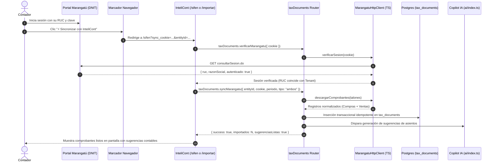

# Especificación de Diseño: Sub-sistema de Sincronización Directa DNIT Marangatú (Protocolo REA) en InteliCont

**Fecha:** 2026-10-25  
**Estado:** Propuesta para Aprobación  
**Objetivo:** Permitir a los estudios contables sincronizar en < 1 segundo sus comprobantes de compras y ventas declarados ante la DNIT (Marangatú / RG 90) directamente hacia InteliCont, mediante el protocolo de ingeniería inversa HTTP (REA) y Bookmarklet 1-Clic, alimentando automáticamente la contabilidad con sugerencias de asientos de IA.

---

## 1. Contexto y Arquitectura

Actualmente, InteliCont permite cargar comprobantes SIFEN subiendo archivos XML uno a uno o en lote desde el disco local.  
Con la integración del protocolo **REA** (desarrollado y probado exitosamente en el proyecto hermano InteliAudit):

1. **Cero fricción para el contador:** El contador entra a su sesión habitual en `https://marangatu.dnit.gov.py/`.
2. **Bookmarklet 1-Clic:** Hace clic en el marcador *"⚡ Sincronizar con InteliCont"* en su barra de navegador. El bookmarklet extrae la cookie de sesión activa (`JSESSIONID`) y redirige a InteliCont con el parámetro seguro.
3. **Ingesta HTTP Ligera en TypeScript:** El backend de InteliCont (`MarangatuHttpClient`) contacta directamente los endpoints internos JSON de la SPA de Marangatú:
   - `consultarSesion.do`: valida el RUC y razón social del contribuyente activo.
   - `talones`: obtiene los talones de presentación de la RG 90 del período.
   - `descargar`: descarga el payload de comprobantes oficiales en ~300ms.
4. **Alimentación Contable Automática:** Los comprobantes se insertan en `tax_documents` con RLS estricto por `entityId` y montos enteros en Guaraníes (`cents/integer`). El Copilot de IA genera inmediatamente las propuestas de asientos contables listas para aprobación en 1-clic.

---

## 2. Diagrama de Flujo



---

## 3. Modelo de Datos y Validación

### Mapeo a `tax_documents`
Los registros recibidos desde Marangatú se mapean al esquema oficial de InteliCont:
- `direction`: `"received"` (para compras) o `"issued"` (para ventas).
- `document_type`: `"invoice"`, `"credit_note"`, `"debit_note"`, etc.
- `document_number`: `NNN-NNN-NNNNNNN`
- `timbrado`: Timbrado oficial del comprobante.
- `issuer_ruc` / `receiver_ruc`: RUC emisor y receptor con DV.
- `total_amount`: Monto entero en Guaraníes (sin decimales, regla inquebrantable de InteliCont).
- `tax_breakdown`: Desglose exacto de Gravadas 10%, Gravadas 5%, Exentas, IVA 10% e IVA 5%.
- `cdc`: Código de Control de 44 dígitos si el comprobante fue electrónico (SIFEN).
- `status`: `"pending_review"`.

### Validador Offline CDC (Módulo 11)
Para comprobantes electrónicos con CDC, se incluye la validación algorítmica local para detectar comprobantes apócrifos o errores de transcripción sin saturar la red.

---

## 4. Interfaces y Endpoints

### 4.1. Módulo Core (`packages/ledger/src/marangatu-rea.ts`)
```typescript
export interface MarangatuSessionInfo {
  valido: boolean;
  ruc?: string;
  nombre?: string;
  error?: string;
}

export interface MarangatuDocumentoRaw {
  tipo: "compra" | "venta";
  cdc?: string;
  timbrado: string;
  numero: string;
  fecha: string;
  rucContraparte: string;
  nombreContraparte: string;
  gravada10: number;
  gravada5: number;
  exenta: number;
  iva10: number;
  iva5: number;
  total: number;
  condicion: "contado" | "credito";
}

export class MarangatuHttpClient {
  verificarSesion(cookie: string): Promise<MarangatuSessionInfo>;
  listarTalones(cookie: string, ruc: string, periodo: string): Promise<any[]>;
  descargarComprobantes(cookie: string, idTalon: string): Promise<MarangatuDocumentoRaw[]>;
}
```

### 4.2. Procedimientos tRPC (`apps/web/src/trpc/routers/tax-documents.ts`)
- `taxDocuments.verificarMarangatu`:
  - Input: `{ cookie: string }`
  - Output: `MarangatuSessionInfo`
- `taxDocuments.syncMarangatu`:
  - Input: `{ entityId: string, cookie: string, periodo: string, tipo: "compras" | "ventas" | "ambos" }`
  - Output: `{ success: boolean, totalImportados: number, importadosCompras: number, importadosVentas: number, cdcsValidados: number }`

### 4.3. Componentes Frontend
- `MarangatuReaModal.tsx`:
  - Generador de Bookmarklet arrastrable con URL adaptada dinámicamente (`app.intelicont.com.py` o `localhost:3000`).
  - Input para pegar cookie de sesión manualmente con botón "Verificar Conexión".
  - Selector de mes/año y botón "Sincronizar ahora".
- Botón *"⚡ Sincronizar Marangatú"* en:
  - Header de [`apps/web/src/app/sifen/page.tsx`](file:///Users/gustaquevedo/Library/CloudStorage/OneDrive-Personal/Dev/Intelicont/apps/web/src/app/sifen/page.tsx).
  - Tarjeta de importación en [`apps/web/src/app/importar/page.tsx`](file:///Users/gustaquevedo/Library/CloudStorage/OneDrive-Personal/Dev/Intelicont/apps/web/src/app/importar/page.tsx).

---

## 5. Estrategia de Testing y Verificación
- **Tests Unitarios (`marangatu-rea.test.ts`)**:
  - Test de normalización y limpieza de cookies (`JSESSIONID=...`).
  - Test de parsing de respuestas de Marangatú a `MarangatuDocumentoRaw`.
  - Test de validación algorítmica de CDC Módulo 11 (casos válidos, DV inválido, longitud incorrecta).
- **Tests de Integración (`tax-documents-sync.test.ts`)**:
  - Ingesta idempotente en `tax_documents` simulando respuesta REA.
  - Verificación de no duplicación de comprobantes preexistentes.
  - Aislamiento multi-tenant por `entityId`.
- **Verificación de Suite y Build**:
  - `pnpm test` (suite completa en verde).
  - `pnpm build` (compilación limpia).
